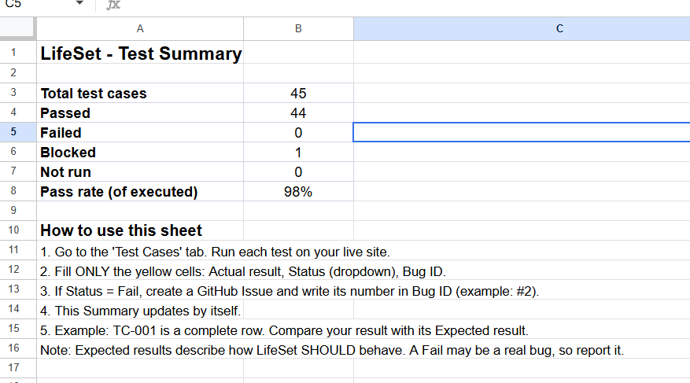

# LifeSet

Kuch bhi expire ya renew hone se pehle alert.

A reminder app for bills, recharges, subscriptions, warranties, and birthdays.

**Live demo:** https://life-set-virid.vercel.app/

## Features
- Add, edit and delete reminders
- Repeat: daily, weekly, monthly, yearly
- Overdue, due today and days-left badges
- Optional amount and alert options (7 days, 1 day, on the day)
- Data saved on the device

## Tech
React + Vite

## Testing
I tested LifeSet manually and tracked the results.

- 45 test cases covering add/edit/delete, amount, alerts, repeat logic, filters, badges, data persistence and mobile layout
- Result: 44 passed, 1 blocked (needs system clock change), 0 failed after fixes
- Bugs found were reported as GitHub Issues and closed after re-testing
- - 32 automated unit tests (Vitest) for date, repeat and amount logic. Run with `npm test`

**Test case sheet:** https://docs.google.com/spreadsheets/d/1X5Gv14-VjqEmNHrjTkpNFoQuEzKBkbSlBvjghe25UJI/edit?usp=sharing

## Status
In development. Android app and notifications coming next.
